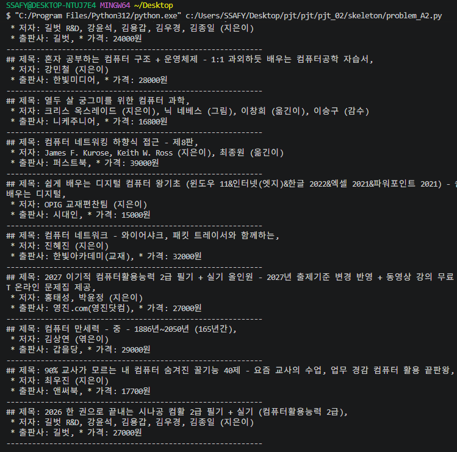
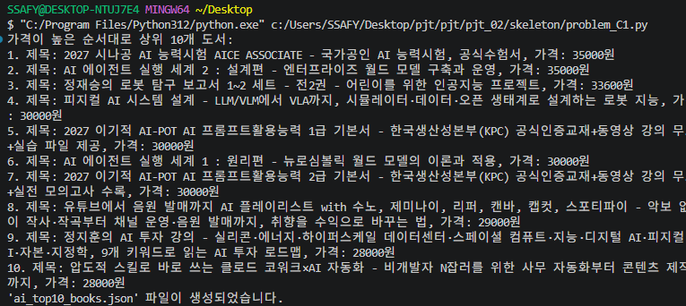

# 관통 2 · 외부 API + 생성형 AI 파이프라인 (2026.09.04)

알라딘 API로 도서 데이터를 수집하고, 생성형 AI로 분석·분류한 뒤 `gTTS`로 음성 파일까지 만드는 자동화 파이프라인입니다.

```
알라딘 API 호출 → 데이터 처리(페이지네이션·중복 제거) → 생성형 AI 분석(JSON 응답) → 결과 가공 → gTTS 음성 파일
```

## 단계별 구현
1. **API 키 관리:** `.env` + `dotenv`로 키를 코드와 분리하고 `.gitignore`로 노출 방지
2. **데이터 수집:** `requests`로 알라딘 API를 호출해 제목·저자·출판사·설명 추출
3. **페이지네이션·중복 처리:** `Start`·`MaxResults`를 바꿔 가며 반복 호출하고 ISBN·도서 ID로 중복 제거
4. **생성형 AI 분석:** 수집한 도서를 내용에 따라 분류하도록 **JSON 형식 응답 프롬프트** 설계
5. **음성 변환:** 생성된 텍스트를 `gTTS`로 `.mp3` 변환

## 어려웠던 점과 해결
- 처음 보는 API 문서에서 요청 파라미터를 구성하고, 여러 페이지에서 원하는 개수만큼 **중복 없이** 모으는 로직
- 생성형 AI가 항상 같은 JSON 형식으로 답하지 않아 생긴 **파싱 오류** → 프롬프트를 구체화하고 예외 처리를 추가해 안정화

## 배운 것
`.env` 키 관리 · `requests` 외부 API 호출 · JSON 처리 · 페이지네이션 · LLM 프롬프트 작성과 응답 파싱 · `gTTS` · 여러 기능을 하나의 데이터 파이프라인으로 연결하는 방법

## 코드
[`code/`](code) — A(API 수집) · B(필터링·TTS) · C(LLM 분류·분석) 단계별 풀이

```bash
cd 02-api-llm-pipeline/code
pip install -r requirements.txt
# .env 에 ALADIN_TTBKEY, GMS_KEY 입력
python problem_C1.py
```

## 실행 화면
| A2 · 키워드 수집 | C1 · AI 분야 상위 10권 |
|---|---|
|  |  |

나머지 단계 실행 화면은 [`screenshots/`](screenshots)에 있습니다. 생성된 음성(mp3)·수집 결과 JSON은 용량·저작권 문제로 제외했습니다.
