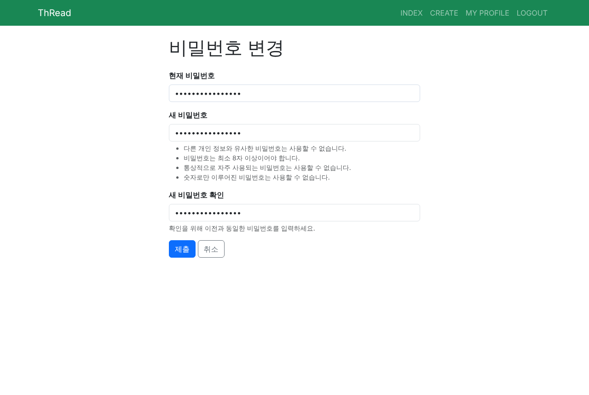
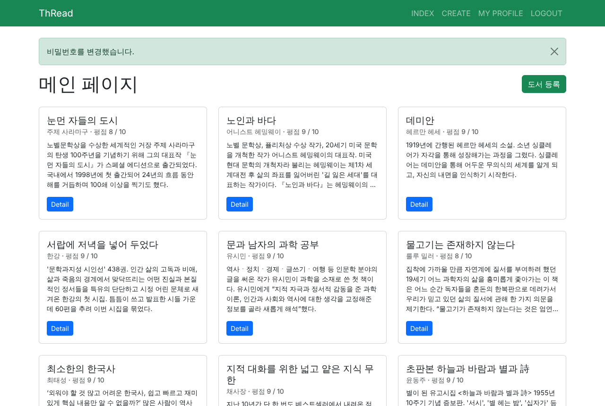
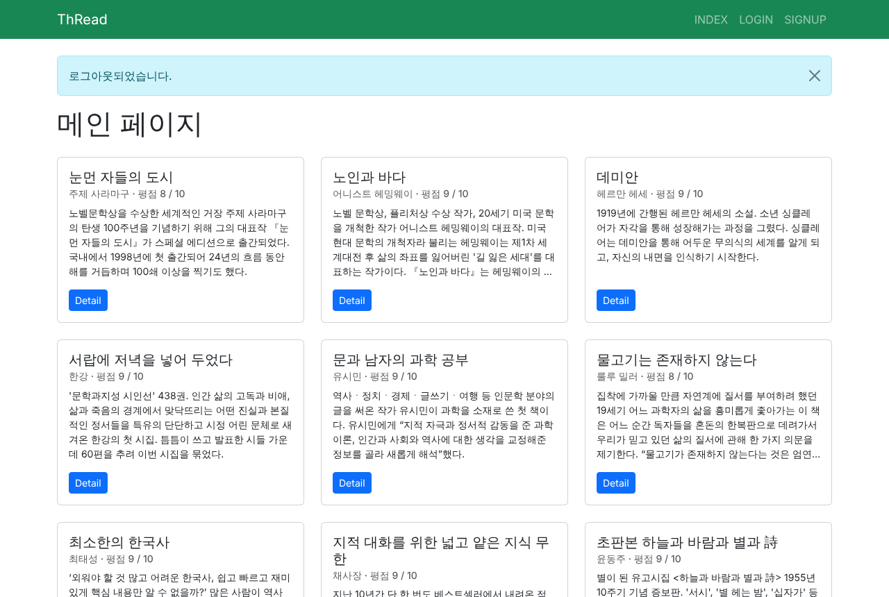
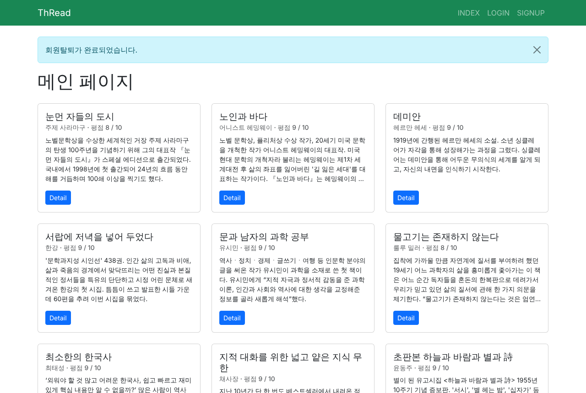
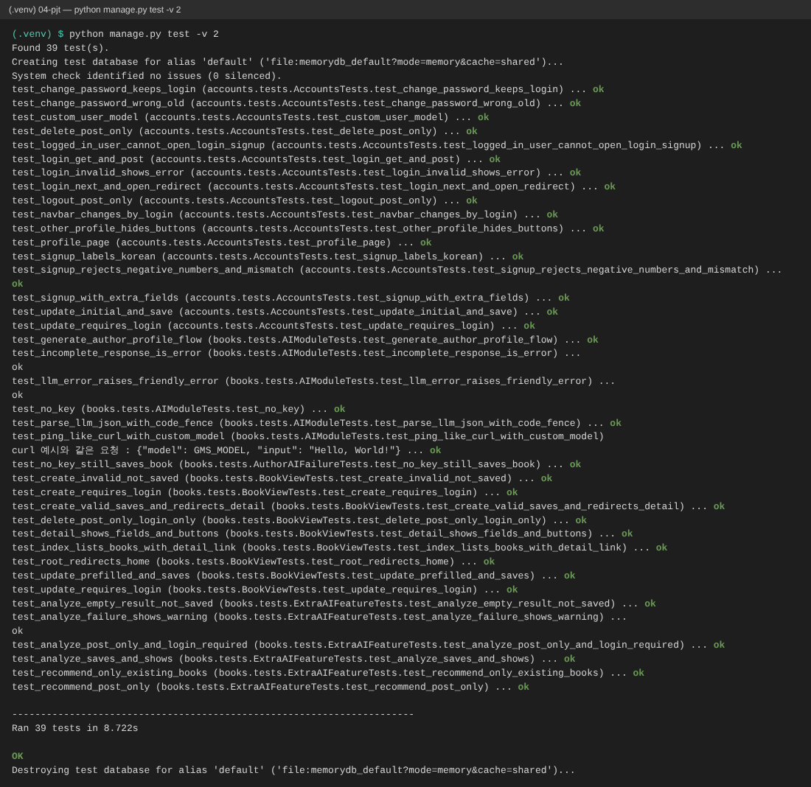

# 관통 4 · Django 인증 + AI 기능

> 기간: 2026.10.22 ~ 10.29 · 2인 팀 · 담당: **백엔드 및 API 기능 구현**

ThRead를 Django 5.2 서비스로 옮기고, 회원 인증과 생성형 AI 기능(작가 정보·도서 분석·추천)을 붙였습니다.

## 구현 내용

### 1. 회원 인증
- `AbstractUser` 기반 **커스텀 User 모델** — 첫 `migrate` 전에 `AUTH_USER_MODEL`을 지정해 이후 필드 확장이 가능하도록 설계
- 로그인 후 `next` 이동 시 `url_has_allowed_host_and_scheme`으로 검증해 **오픈 리다이렉트 방어**
- 로그아웃은 **POST만 허용**, 뷰마다 `require_safe` / `require_http_methods` / `require_POST`로 허용 메서드 제한(그 외 405)
- `UserCreationForm`의 `Meta`를 오버라이드해 커스텀 User에 맞춤, 비밀번호 변경 후 `update_session_auth_hash`로 로그인 유지
- 관심 장르 등 추가 회원 필드는 `MultipleChoiceField`로 입력, 프로필 페이지 제공

### 2. 도서 CRUD
- `ModelForm` + 공통 `BootstrapFormMixin`으로 폼 스타일을 한 곳에서 관리
- 작성자만 수정·삭제 가능하도록 권한 확인

### 3. 생성형 AI 기능
- `call_llm()` 공통 함수 — Responses API 호출, reasoning effort `low`, 실패 시 예외를 잡아 서비스는 계속 동작
- **AI 작가 정보**: Wikipedia 요약 + LLM으로 작가 소개를 **JSON 형식**으로 받아 저장
- **AI 도서 분석**: 분석 결과를 `JSONField`에 저장해 재요청 없이 재사용
- **AI 추천**: LLM이 돌려준 추천 중 **실제 등록된 도서 id만** 남기도록 검증(없는 책을 지어내는 경우 차단), 결과는 세션에 캐시

### 4. 데이터 수집 명령
- 알라딘 API로 도서를 불러오는 `import_books` 관리 명령
- `update_or_create`로 재실행해도 중복이 생기지 않게 하고, 태그 → 엔티티 순서로 저장하도록 순서 문제를 수정

### 5. 테스트
- **자동 테스트 45개** — 인증 흐름, 메서드 제한, 권한, AI 응답 검증 등
- 외부 API·LLM 호출은 `mock`으로 대체해 네트워크 없이 재현 가능하게 구성

## 기술
Python · Django 5.2 · Bootstrap 5.3 · SQLite · LLM API(Responses API) · Wikipedia API · 알라딘 Open API · unittest.mock

## 실행 화면

| 비밀번호 변경 | 변경 후 로그인 유지 | 로그아웃(POST) | 회원 탈퇴 |
|---|---|---|---|
|  |  |  |  |

테스트 실행 화면 (AI 기능 추가 전 39개 시점 캡처 · 현재 코드는 45개 통과):



## 실행 방법

```bash
cd 04-django-auth-ai/code
python -m venv venv && source venv/bin/activate
pip install -r requirements.txt
cp .env.example .env        # GMS_KEY, TTBKEY 입력 (없어도 AI 기능만 꺼지고 실행됨)
python manage.py migrate
python manage.py import_books   # 알라딘 API로 도서 불러오기 (TTBKEY 필요)
python manage.py runserver
python manage.py test           # 45 tests
```

> SSAFY 제공 데이터로 만든 샘플 fixture(`books/fixtures`)는 저장소에서 제외했습니다.
