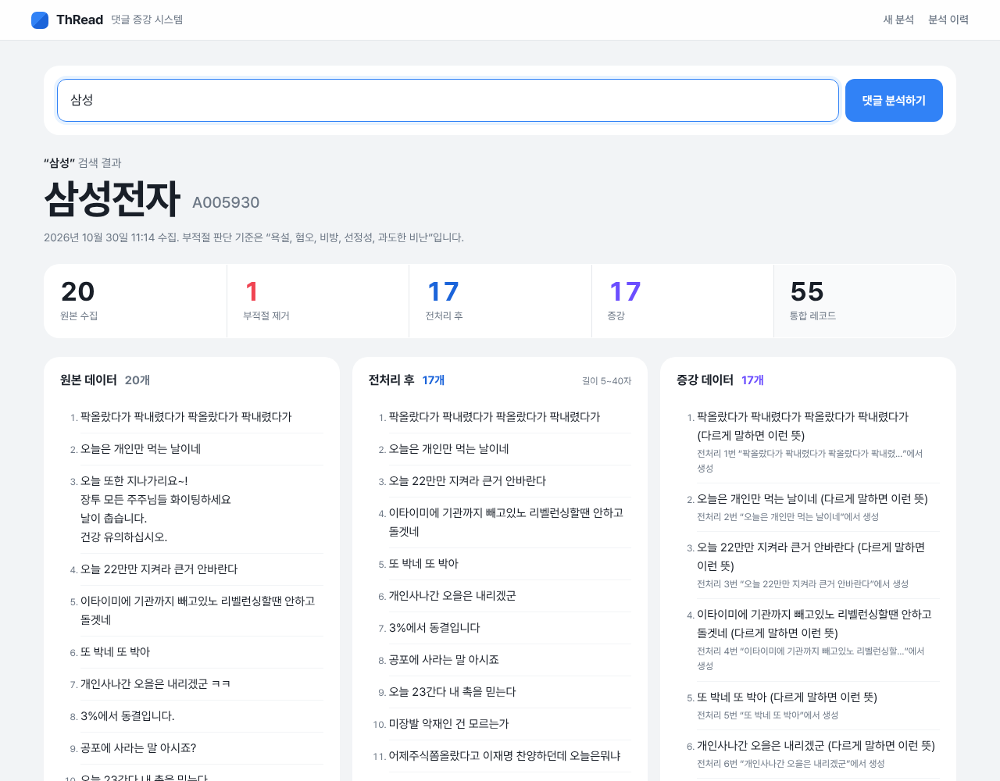

# 관통 5 · 크롤링 + LLM 데이터 파이프라인

> 기간: 2026.10.30 · 2인 팀 · 담당: **백엔드 및 데이터 파이프라인 구현**

종목 커뮤니티 댓글을 수집해 **LLM 판단 → 정제 → 통계 기준 → 증강·요약**까지 한 번에 처리하고, 진행 상황을 화면에 실시간으로 보여주는 파이프라인입니다.



## 파이프라인

```
Selenium 댓글 수집 → LLM 부적절 판단 → pandas 정제 → IQR 길이 기준 → LLM 증강 → 요약
                         (진행 상황을 NDJSON으로 스트리밍)
```

## 구현 내용

### 1. 크롤링 (Selenium)
- `/` 단축키 검색으로 종목 페이지 진입, 페이지 제목이 바뀔 때까지 기다려 **실제 회사명** 확보
- 자주 바뀌는 클래스명 대신 `span[style*='--fold-after-lines']` 같은 **속성 선택자**로 댓글 본문 추출
- 페이지 전체가 아닌 **내부 스크롤 영역**을 스크롤해 댓글을 추가 로딩

### 2. LLM 판단 — "판단만 맡기고 코드로 검증"
- LLM은 부적절한 댓글의 **번호만** 반환, 코드가 범위를 검사한 뒤 **뒤에서부터** 제거해 인덱스가 밀리지 않게 처리
- 증강 결과는 입력과 **개수가 다르면 재시도**

### 3. 정제·통계
- pandas + 정규식으로 URL·특수문자·중복 정리
- IQR로 댓글 길이 기준을 계산하되 **5~76자 범위로 제한**해 극단값 방지

### 4. 스트리밍과 예외 처리
- 단계별 결과를 합쳐 기록, `StreamingHttpResponse` + **NDJSON**으로 진행 상황 전송(스레드 + 큐)
- 실패 단계마다 상태를 구분해 안내, 키 없이 시연 가능한 **샘플 모드** 제공
- UI 테마 11종

### 5. 확장 — Market Pulse
- 같은 Selenium 세션으로 KOSPI · KOSDAQ · USD/KRW 지표를 함께 수집

### 6. 테스트
- 크롤러·LLM 호출을 `mock`으로 대체한 테스트

## 기술
Python · Django · Selenium · pandas · 정규식 · LLM API · StreamingHttpResponse(NDJSON) · threading/queue
