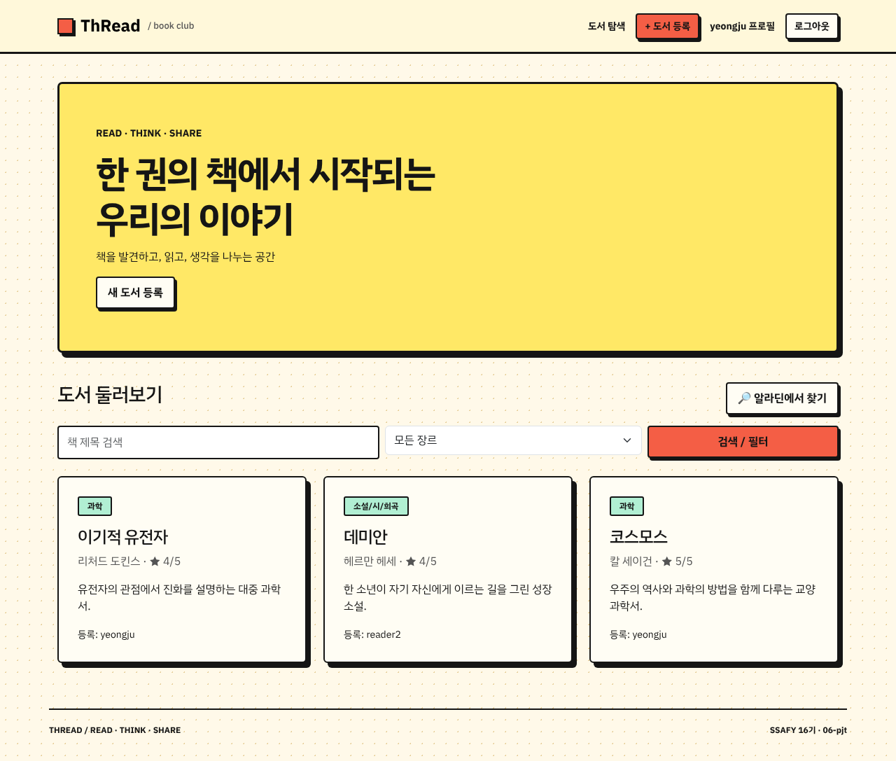
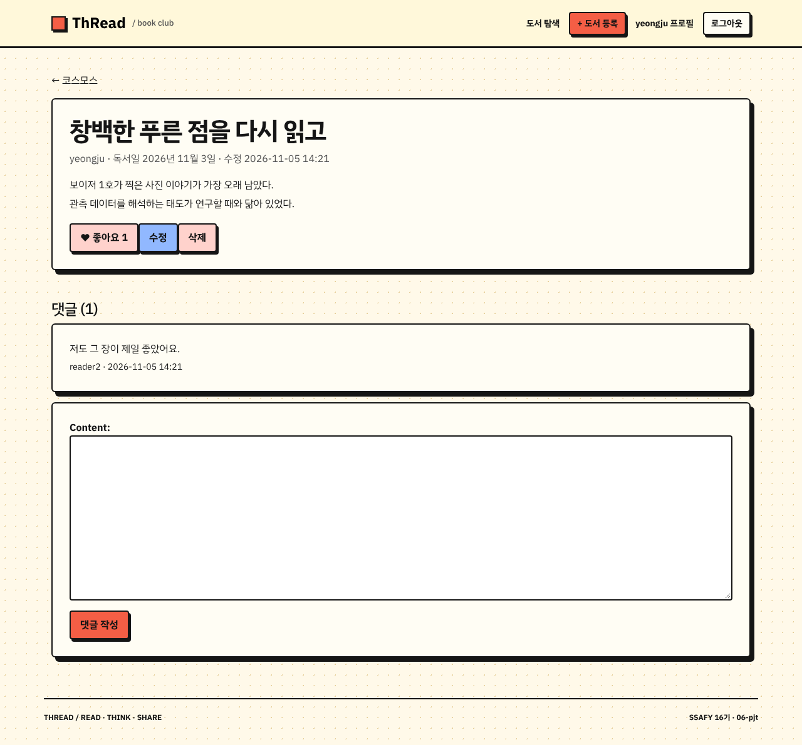
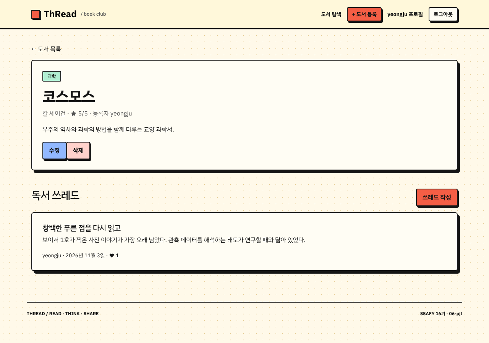
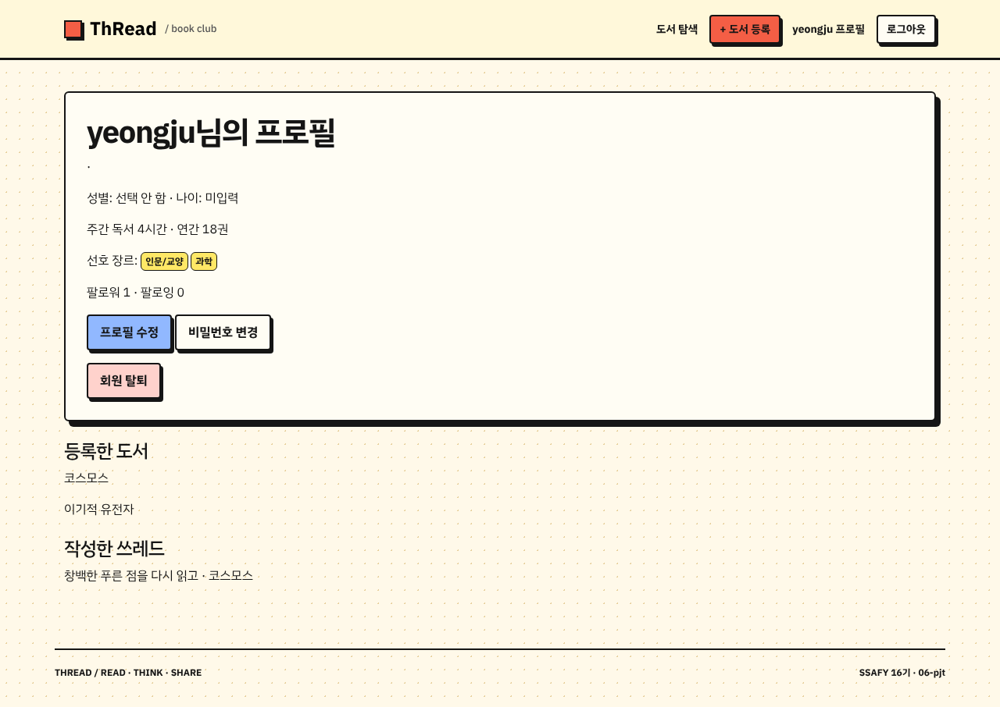

# 관통 6 · 관계형 DB 설계 (Django ORM)

> 기간: 2026.11.05 · 2인 팀 · 담당: **백엔드 · DB 설계**

지난 회차까지 페이지 단위로 따로 움직이던 도서 기능을 **하나의 관계형 데이터 모델**로 묶었습니다.
회원 → 도서 → 쓰레드 → 댓글로 이어지는 1:N과 팔로우·좋아요·선호 장르 M:N을 설계하고, 작성자 권한·HTTP 메서드 제한을 붙였습니다.

| 도서 목록 · 장르 필터 | 쓰레드 상세 · 좋아요 · 댓글 |
|---|---|
|  |  |
| **도서 상세 · 쓰레드 목록** | **프로필 · 팔로우 · 작성 기록** |
|  |  |

<sub>로컬에서 서버를 띄워 직접 캡처한 화면입니다. 도서·쓰레드는 캡처용으로 입력한 예시 데이터입니다.</sub>

## 데이터 모델

```
User ─┬─ 1:N ─ Book ─ 1:N ─ Thread ─ 1:N ─ Comment
      ├─ 1:N ─ Thread            └─ M:N ─ User   (likes)
      ├─ 1:N ─ Comment
      ├─ M:N ─ User              (followings, symmetrical=False)
      └─ M:N ─ Category          (favorite_categories)
Category ─ 1:N ─ Book            (on_delete=SET_NULL)
```

| 결정 | 이유 |
|---|---|
| `AbstractUser` 상속 커스텀 User | 성별·나이·독서 시간·연간 독서량·프로필 이미지를 회원 자체 속성으로 저장. 프로젝트 시작 시점에 `AUTH_USER_MODEL` 지정 |
| 팔로우는 `ManyToManyField('self', symmetrical=False)` | A가 B를 팔로우해도 B가 A를 팔로우한 것은 아님 → 방향 있는 관계 |
| 장르 삭제 시 도서는 `SET_NULL` | 장르를 정리해도 사용자가 쓴 도서·쓰레드가 같이 사라지지 않게 |
| 도서·쓰레드·댓글은 작성자 삭제 시 `CASCADE` | 탈퇴한 회원의 글을 남기지 않음 |
| 마이그레이션을 `accounts/0001 → books/0001 → accounts/0002`로 분리 | User ↔ Category가 서로를 참조하는 순환 의존을 피하기 위해, 선호 장르 필드만 뒤 단계에서 추가 |
| 평점은 모델 validator(1~5) | 폼이 아니라 모델에서 막아 관리자 화면·명령어 입력에도 같은 규칙 적용 |

## 권한 · 요청 처리

- 수정·삭제는 `get_object_or_404(Model, pk=pk, user=request.user)` — 남의 글이면 **404** (존재 여부도 드러내지 않음)
- 삭제·좋아요·팔로우·댓글은 `@require_POST`, 로그인 필요한 화면은 `@login_required`
- 자기 자신은 팔로우할 수 없게 뷰에서 차단
- 비밀번호 변경 후 `update_session_auth_hash()`로 로그인 유지
- 목록·상세는 `select_related('user', 'category')`로 N+1 조회 방지

## 추가 구현

- **알라딘 도서 검색 → 등록 폼 채우기**: 검색 결과를 바로 저장하지 않고, 선택한 책 정보를 Django `signing` 토큰(1시간 유효)에 담아 등록 폼으로 넘깁니다. 사용자가 평점·장르를 정해 제출할 때 토큰을 다시 검증하고, **제목·저자가 토큰과 같을 때만** ISBN·표지·출판사를 저장합니다. 클라이언트가 값을 바꿔도 메타데이터를 위조할 수 없습니다.
- **작가 정보 · 쓰레드 커버 (선택)**: 위키백과 검색 + LLM 요약, 이미지 생성. API 키가 없거나 호출이 실패해도 도서·쓰레드 저장은 그대로 되고, 경고 메시지만 보여 줍니다. 생성된 작가 정보에는 "AI가 생성한 정보" 안내를 붙였습니다.
- **소개 누락 도서 채우기 명령** (`generate_book_descriptions`): 소개가 비어 있는 책만 골라 처리하고, 결과 앞에 `[AI 작성 도서 안내]` 표시. `--dry-run`, 실패 시 기존 값 유지, 재실행해도 이미 채운 책은 건너뜁니다.

## 검증

로컬(Python 3.13 · Django 5.2.19)에서 직접 실행한 결과입니다.

```
python manage.py check                          → System check identified no issues
python manage.py makemigrations --check --dry-run → No changes detected
python manage.py migrate                        → 전체 적용 성공
python manage.py test accounts books            → Ran 36 tests ... OK
```

테스트 범위: 로그인·로그아웃(GET 405), 회원가입·정보 수정, 비밀번호 변경 후 세션 유지, 팔로우 토글·자기 팔로우 차단,
도서·쓰레드 CRUD, 작성자가 아닌 사용자의 수정·삭제 404, 좋아요 토글, 댓글 권한·빈 댓글 거부, 장르 필터,
알라딘 토큰 위조·만료 거부(외부 요청은 mock), AI 소개 생성 명령의 dry-run·재실행·실패 시 원본 유지.

외부 API(OpenAI·알라딘·GMS)를 실제로 호출하는 경로는 키가 필요해 이 저장소의 테스트에서는 mock으로만 확인했습니다.

## 실행

```bash
cd 06-relational-db/code
python -m venv venv && source venv/bin/activate
pip install -r requirements.txt
cp .env.example .env          # AI·알라딘 키는 비워 둬도 기본 기능은 동작
python manage.py migrate
python manage.py seed_categories
python manage.py runserver
```

## 공개 범위

- 직접 작성한 코드와 직접 캡처한 화면만 포함했습니다.
- 수업 제공 데이터·다른 팀 프로젝트에서 가져온 도서 데이터(`data/catalog_100.sqlite3`)는 포함하지 않았습니다. 그래서 `seed_catalog` 명령은 이 저장소만으로는 실행되지 않습니다.
- API 키는 `.env`에만 두며 저장소에 없습니다.
