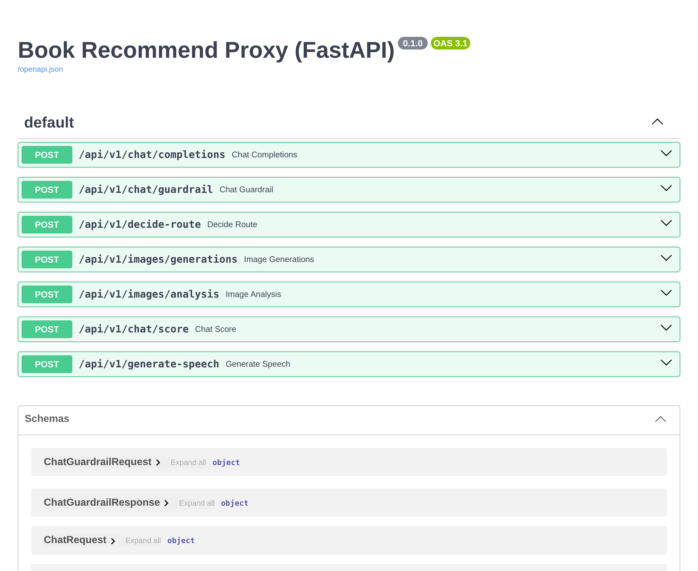

# 관통 7 · AI 프록시 서버 (FastAPI · 멀티모달)

> 기간: 2026.11.06 · 2인 팀 · 담당: **FastAPI 프록시 · AI 연동 · 테스트** (팀 README 역할표 기준)

도서 추천 서비스의 AI 기능을 **Django → FastAPI 프록시 → SSAFY GMS** 구조로 분리했습니다.
브라우저나 Django는 모델을 직접 부르지 않고, GMS 키와 모델 선택·응답 검증은 프록시 한곳에서만 다룹니다.



<sub>공개본 프록시를 로컬에서 실행해 직접 캡처한 /docs 화면입니다.</sub>

```
Django (8080) ──HTTP, 최대 180초──▶ FastAPI 프록시 (8081) ──최대 120초──▶ GMS
                                     ├─ Guardrail: 부적절한 요청은 생성 전에 403
                                     ├─ 라우트 결정: 텍스트 추천 / 표지 이미지 생성
                                     ├─ 난이도별 모델: 간단 → nano, 복잡 → mini (선택형 상위 모델 별도)
                                     ├─ OpenAI 호환 API: 추천·이미지 분석·점수·TTS
                                     └─ Gemini Interactions API: 표지 이미지 생성
```

## 내가 구현한 것 (F702~F711)

| 요구사항 | 엔드포인트 | 구현 |
|---|---|---|
| F702 추천 생성 | `POST /api/v1/chat/completions` | 입력 검증 → Guardrail → 모델 선택 → 생성, 실제 쓴 모델명(`model_used`)을 함께 반환 |
| F703 Guardrail | `POST /api/v1/chat/guardrail` | JSON Schema(`strict`)로 `is_appropriate` 불리언만 받음. 형식이 깨지면 통과가 아니라 **503 (fail-closed)** |
| F704 라우트 결정 | `POST /api/v1/decide-route` | enum 두 값만 허용, 그 밖의 값은 503 |
| F705·F712 표지 생성 | `POST /api/v1/images/generations` | Gemini는 OpenAI 도메인이 아닌 별도 게이트웨이(`x-goog-api-key`)로 호출. 응답 구조가 4가지(`candidates`·`output_image`·`steps`·`outputs`)라 모두 처리하고, PNG/WEBP도 **실제 JPEG**로 다시 인코딩(20MB·2,500만 픽셀 제한) |
| F706 공통 오류 | 전체 | 외부 실패·타임아웃·형식 오류를 모두 `503 model server error`로 통일. 로그에는 키·본문 대신 응답 **구조만** 남김 |
| F707 이미지 분석 | `POST /api/v1/images/analysis` | base64를 엄격히 디코딩하고, 파일 앞부분 시그니처로 JPEG·PNG·GIF·WEBP를 판별해 data URI의 MIME 결정 |
| F709 점수 | `POST /api/v1/chat/score` | 0~100 정수와 이유. 범위·타입이 다르면 503 |
| F710 모델 라우팅 | (F702 안) | 요청 난이도를 먼저 분류해 nano/mini 선택 |
| F711 TTS | `POST /api/v1/generate-speech` | MP3를 base64로 반환 (Guardrail 통과 후) |

## 판단한 것

- **모델 출력은 형식부터 검증한다.** Guardrail·라우트·점수는 모두 JSON Schema로 받고, 코드에서 타입·범위·enum을 한 번 더 확인합니다. 모델이 이상한 값을 주면 "통과"로 흘려보내지 않고 503으로 막습니다.
- **API마다 다른 계약을 프록시가 흡수한다.** 텍스트는 OpenAI 호환, 이미지는 Gemini Interactions로 경로·인증 헤더·응답 구조가 모두 다릅니다. Django 쪽은 항상 같은 응답(`image_base64` = JPEG)만 받습니다.
- **로그에 비밀을 남기지 않는다.** 이미지 응답 디버깅이 필요했지만 원문 대신 키 이름·리스트 길이·문자열 길이만 출력하는 함수를 따로 만들었습니다.

## 검증

```
python -m unittest discover -s tests -v   → Ran 20 tests ... OK   (Python 3.13, 공개본 기준)
uvicorn main:app --port 8081              → /docs 에 엔드포인트 7개 확인
```

- 테스트는 GMS를 호출하지 않고 mock으로 계약을 확인합니다: Guardrail true/false, 형식 오류 시 503, 거부 시 이미지 생성 미호출(호출 1회), 라우트 2종, 난이도별 모델(mini 선택), 선택형 모델, 점수, 이미지 MIME·잘못된 base64(422), TTS, Gemini 게이트웨이 주소·헤더, PNG→JPEG 변환, 401을 안전한 503으로 바꾸기.
- 실제 GMS 호출은 키가 필요해 이 저장소에서는 확인하지 않았습니다. 팀 README에도 **이미지 생성은 GMS 응답에 이미지가 담기지 않은 사례가 있어 최종 성공 미확인**으로 기록돼 있습니다.

## 공개 범위

- 공개: 직접 구현한 프록시 코드(`proxy/main.py`의 F702~F711)와 테스트.
- 제외: SSAFY 제공 코드(GMS 호출 함수 `ask_gms`, 요청·응답 스키마 원본, 명세서), 팀원이 맡은 Django 화면, `.env`·DB·생성 이미지.
  - `ask_gms` 자리에는 항상 503을 돌려주는 대체 함수를, `schemas.py`에는 필드만 맞춘 최소 정의를 새로 두었습니다. 그래서 공개본만으로는 실제 모델을 부를 수 없고, 테스트는 mock으로 실행됩니다.
  - 원본 테스트 중 SSAFY 제공 함수 자체를 검사하던 1건은 뺐고, `test_malformed_text_response_becomes_503`은 대체 함수 때문에 공개본에서는 응답 파싱까지 검사하지 못합니다.

## 실행

```bash
cd 07-ai-proxy/code
python -m venv venv && source venv/bin/activate
pip install -r requirements.txt
python -m unittest discover -s tests -v
cd proxy && uvicorn main:app --port 8081
```
