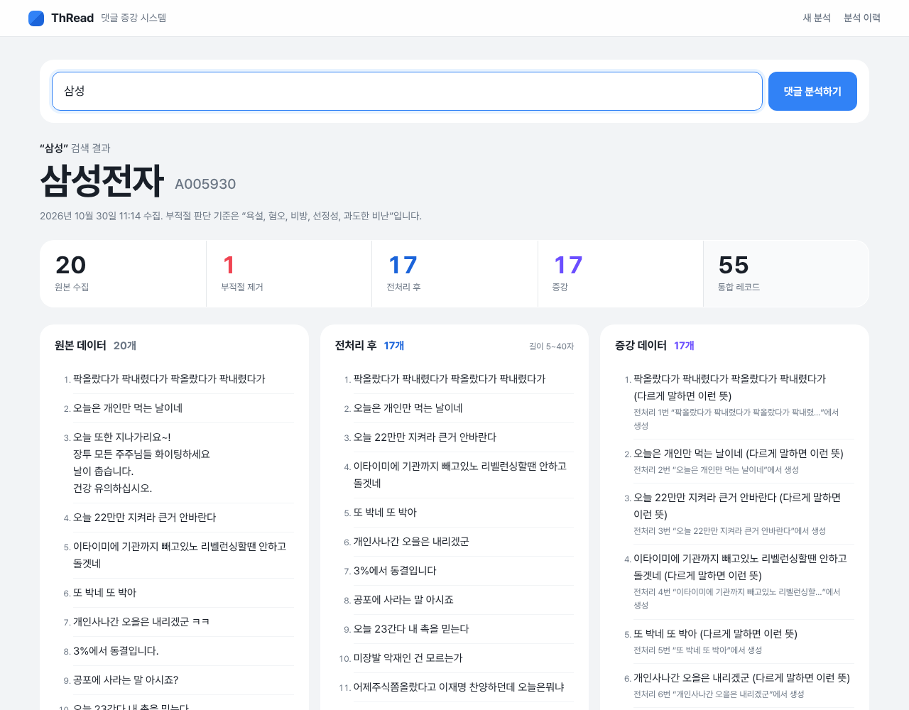

# 📚 ThRead — SSAFY 16기 관통 프로젝트

> 도서 추천 · 독서 커뮤니티 서비스 **ThRead**를 6회에 걸쳐 확장하며
> **데이터 처리 → 외부 API·LLM → 웹 화면 → Django 인증 → 크롤링·LLM 데이터 파이프라인 → 관계형 DB 설계**까지 구현한 기록입니다.

| | |
|---|---|
| 과정 | 삼성 청년 SW·AI 아카데미(SSAFY) 16기 · 2026.07 ~ |
| 형태 | 회차별 2인 팀 프로젝트 |
| 담당 | **백엔드 · 데이터 파이프라인** (Django 구조·DB 설계, 생성형 AI·외부 API 연동, 크롤러, 테스트) |
| 기술 | Python · Django 5.2 · Selenium · pandas · LLM API(GMS Responses API) · Bootstrap 5.3 · SQLite |

## 회차별 프로젝트

| 회차 | 폴더 | 주제 | 핵심 |
|---|---|---|---|
| 1 | [`01-python-data`](01-python-data) | Python 도서 데이터 분석 | JSON 파싱, 집계·분류·정렬 |
| 2 | [`02-api-llm-pipeline`](02-api-llm-pipeline) | 외부 API + 생성형 AI | 알라딘 API 수집(페이지네이션·중복 제거) → LLM 분류(JSON 응답) → gTTS 음성 변환 |
| 3 | [`03-responsive-web`](03-responsive-web) | 반응형 웹페이지 | Bootstrap Navbar·Carousel·Grid·Modal·Tabs, 미디어 쿼리 |
| 4 | [`04-django-auth-ai`](04-django-auth-ai) | Django 인증 + AI 기능 | 커스텀 User, 오픈 리다이렉트 방어, AI 작가 정보·분석·추천, 알라딘 수집 명령, **자동 테스트 45개** |
| 5 | [`05-crawling-llm-pipeline`](05-crawling-llm-pipeline) | 크롤링 + LLM 데이터 파이프라인 | Selenium 댓글 수집 → LLM 부적절 판단 → pandas 정제 → IQR 기준 → LLM 증강·요약, 진행 상황 스트리밍 |
| 6 | [`06-relational-db`](06-relational-db) | 관계형 DB 설계 | 커스텀 User, 1:N·M:N(팔로우·좋아요·선호 장르), 순환 참조 없는 마이그레이션, 작성자 권한(타인 글 404), 서명 토큰으로 알라딘 메타데이터 위조 방지, **자동 테스트 36개** |

## 설계에서 가장 신경 쓴 원칙

**LLM에는 판단만 맡기고, 결과는 코드로 검증한다.**

- 부적절 댓글은 LLM이 **번호만** 돌려주고, 코드가 범위를 검사한 뒤 **뒤에서부터** 원본에서 제거 (관통 5)
- 증강 결과는 입력과 **개수가 다르면 재시도** — 원본과 짝이 맞지 않는 결과는 쓰지 않음 (관통 5)
- AI 추천은 **등록된 도서 id만** 남기도록 검증 — 없는 책을 지어내도 걸러냄 (관통 4)
- LLM·외부 API가 실패해도 서비스는 동작하고, 실패 사실만 안내 (관통 4·5·6)
- 외부에서 받은 도서 정보는 서명 토큰으로 묶어, 사용자가 값을 바꿔 제출하면 메타데이터를 저장하지 않음 (관통 6)

## 공개 범위

이 저장소에는 **직접 작성한 코드와 문서, 직접 캡처한 실행 화면**만 포함했습니다.
SSAFY에서 제공한 명세서, 기본(스켈레톤) 코드, 제공 데이터는 포함하지 않았습니다. API 키는 `.env`로 분리되어 있으며 저장소에 없습니다.
